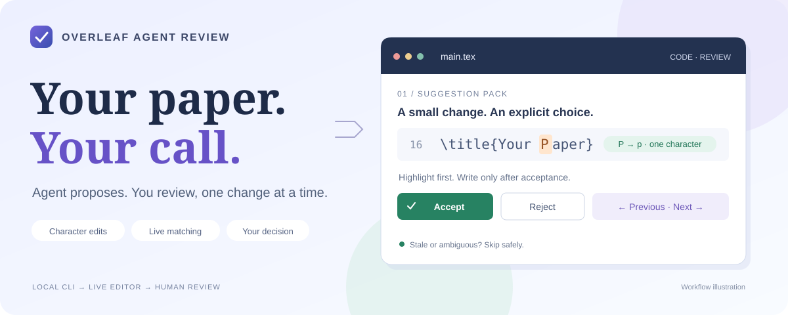
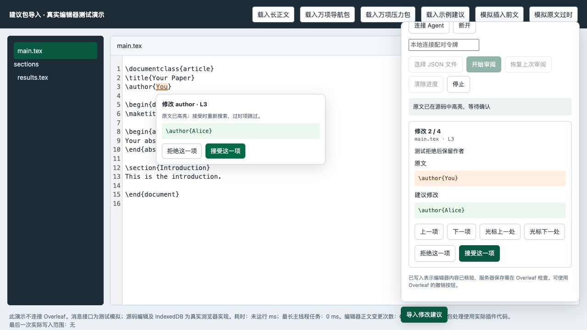

<div align="center">



# Overleaf Agent Review

**AI suggestions. Live LaTeX. Your final say.**

Review one change at a time, directly inside Overleaf.

[](https://github.com/MatZaharia/overleaf-agent-review/releases/tag/v1.6.1)
[](https://github.com/MatZaharia/overleaf-agent-review/actions)
[](LICENSE)
[](#install)
[](AGENTS.md)

**English** · [简体中文](README.zh-CN.md)

[Download extension](https://github.com/MatZaharia/overleaf-agent-review/releases/tag/v1.6.1) · [Connect your Agent](#local-agent-connection) · [Agent guide](docs/agent-guide.md) · [Report an issue](https://github.com/MatZaharia/overleaf-agent-review/issues)

</div>

---

Your Agent sends a suggestion pack. Overleaf highlights the changed characters. **You accept, reject or come back later.** Each acceptance checks the current source again; stale, already-applied or ambiguous suggestions are skipped.

## ✨ What you get

| 🔎 Review in place | ✍️ Change only the characters | 🧭 Follow your cursor |
| :--- | :--- | :--- |
| Inspect suggestions inside the live source editor. No separate manuscript diff to juggle. | Even a sentence-sized matching anchor writes only the changed characters. | Move by suggestion order or find the closest pending change before/after your cursor. |
| **📦 Up to 10,000 suggestions** | **🔌 Local Agent bridge** | **🛡️ You stay in control** |
| Paged delivery and saved progress keep large packs manageable. | Validate and publish from a CLI. Existing review notes can go straight into a pack. | Pair manually. No remote acceptance endpoint. Source reading is optional and on demand. |

## 👀 A look inside



*Actual browser demo with the extension code and a real CodeMirror editor. Test manuscript; this is not a live Overleaf screenshot. The extension interface is currently Chinese.*

> **Have your review notes ready?** If they contain exact originals, replacements and file paths, your Agent can convert and publish them without reading the online manuscript first.

**Start here:** [Install](#install) → [Pair](#local-agent-connection) → [Send suggestions](#workflow-with-an-agent) → [Review & navigate](#review-navigation)

<details>
<summary><strong>📚 Browse the documentation</strong></summary>

- [Quick test](#quick-test)
- [Suggestion format](#suggestion-format) and [examples](examples/)
- [Behavior and limits](#behavior-and-limits)
- [Privacy](#privacy)
- [Development](#develop) and [contributing](CONTRIBUTING.md)
- [Agent instructions](AGENTS.md) and [reusable prompt](docs/agent-prompt.md)

</details>

---

## Install

1. Download the extension ZIP from [Releases](https://github.com/MatZaharia/overleaf-agent-review/releases/tag/v1.6.1) and extract it. Use the extension asset, rather than GitHub's automatically generated source ZIP.
2. Open `chrome://extensions` in Chrome and enable **Developer mode**.
3. Click **Load unpacked** and select the extracted `overleaf-agent-review` folder containing `manifest.json`.
4. Open your Overleaf project and refresh the page. Select **Code** mode.
5. Click **导入修改建议** (Import suggestions) at the bottom right.

The interface supports **中文 / English**, selectable in the right panel header and saved locally.

To update, replace the files in the installed folder, click Reload on the extension card, and refresh Overleaf. Installation in the Codex in-app browser has not been verified; the supported installation path is Chrome.

## Local Agent connection

For the first connection, follow this order. **The Agent uses the local CLI to submit suggestions; you control the browser, installation, pairing and every accept/reject decision.**

1. **Install or update the extension yourself** using the steps above. Load v1.4.0 or later, refresh the real Overleaf project and select Code mode. The local demo cannot pair your real project.
2. **Ask the Agent to start the bridge** from the absolute path of your local repository or extracted extension directory. Node.js 22+ is required; runtime CLI commands need no npm installation:

   ```sh
   node bridge/cli.js start
   ```

   Keep the process running. First startup creates a random token in that directory's `work/bridge.json` with mode 600. Reusing the same config reuses the token. If a service is already running, use its config instead of starting a duplicate.
3. **Obtain the token and pair manually**: read the config's `token` field, or explicitly ask the Agent to provide it in your private session. In the real Overleaf project, open **导入修改建议**, enter **本地连接配对令牌**, and click **连接 Agent**. Pair each project separately. Keep the token out of packs, logs, public chats and GitHub.
4. **Tell the Agent you have paired, then provide your review notes**. Existing packs can be validated and published directly; notes with exact originals, replacements and paths can be converted without first reading online source. From the tool directory, run:

   ```sh
   node bridge/cli.js validate --file work/suggestions.json --project PROJECT_ID
   node bridge/cli.js publish --project PROJECT_ID --file work/suggestions.json
   ```

   Replace `PROJECT_ID` with the 24-character ID after `/project/` in the Overleaf URL. For publish / status / read from another working directory, add `--config /absolute/path/to/tool/work/bridge.json`.
5. **Make each decision yourself in Overleaf**. Receiving a pack opens its preview but accepts nothing. Accept, reject or navigate to defer an item; only acceptance writes source. The Agent can query `node bridge/cli.js status --project PROJECT_ID` when feedback is needed. Report successful publishing as “submitted for review,” not “manuscript changed.”

A setup prompt you can give your Agent:

```text
Local tool directory: [absolute path]
Target Overleaf project: [project URL]
Read AGENTS.md and docs/agent-guide.md first.
Start the local bridge and tell me the token file location. Provide the
pairing token only in this private session if I explicitly request it.
Do not control the browser, install the extension, fill pairing fields,
or accept/reject suggestions. Wait until I say pairing is complete,
then generate, validate and publish a pack from my review notes.
Do not read source first when exact originals are already available.
I decide whether to accept every manuscript change.
```

**Later sessions**: while the same service runs and the page stays connected, publish new packs directly; pairing is not required for every pack. After refreshing Overleaf, enter the token and connect again. The token remains the same when using the same config. Restarting the service clears its in-memory packs, so publish again. Stop review does not disconnect; click **断开** to stop local transfers. If not connected, the Agent should save the validated pack and report that delivery has not succeeded; manual file import remains available. See [local bridge details](docs/local-bridge.md).

Receiving a new pack opens review automatically, but never accepts a change. A received new revision cancels the old preview. The drawer retains only the latest 100 history rows to keep 10,000-item packs manageable. File imports avoid expanding large JSON in the textarea. Suggestion packs, decisions and anchor journals are saved in the extension’s local IndexedDB. Click **恢复上次审阅** to resume after a refresh. Unchanged accepted/rejected suggestions retain their decisions across pack updates; changed suggestion fields require another review. **清除进度** resets the current project’s saved session without changing Overleaf source. Skipped suggestions are checked again on resume.

## Workflow with an Agent

**Agent entry point: [AGENTS.md](AGENTS.md) → [Agent guide (English / 中文)](docs/agent-guide.md).** The main workflow is to generate, validate and publish a review pack, then let the user accept or reject each item in Overleaf. Source reading is an optional capability. Already-written packs can be validated and published directly; notes containing exact originals, replacements and file paths can be converted without reading the online manuscript.

After the [first connection workflow](#local-agent-connection), ask your Agent to write `work/suggestions.json` from exact source it already has, then run:

```sh
node bridge/cli.js validate --file work/suggestions.json --project PROJECT_ID
node bridge/cli.js publish --project PROJECT_ID --file work/suggestions.json
node bridge/cli.js status --project PROJECT_ID
```

Use the project ID from your Overleaf URL. `validate` works offline, without pairing or a token. `publish` submits suggestions; it does not accept or write them. Check `status` when you need feedback. If the bridge is unavailable, import the generated JSON file manually. A reusable [English / Chinese prompt](docs/agent-prompt.md) is included.

The bridge CLI and JSON format are independent of any model provider. The current workflow was developed with Codex; other Agents with local file and shell access can use the same interface, but their integrations have not been separately verified. The extension calls no AI API. Exact original text is required; ask for missing source or optionally use the on-demand `read` command rather than inventing it.

## Quick test

In a disposable project containing `\title{Your Paper}`, paste this pack into the importer:

```json
{
  "format": "codex-overleaf-suggestions",
  "version": 1,
  "suggestions": [
    {
      "id": "title-case",
      "file": "main.tex",
      "original": "\\title{Your Paper}",
      "replacement": "\\title{Your paper}",
      "reason": "Change only P to p"
    }
  ]
}
```

Click Start review. Only `P` is highlighted; the source stays unchanged until you accept. Accepting changes `P` to `p`. Rejecting retains the original. Reimporting after acceptance skips the already-applied suggestion. Changing the original to a nonexistent title tests stale skipping. Use Overleaf's Undo button or an inverse suggestion to restore your test change.

The displayed line number is informational. It is never used as the replacement address.

If Chrome reports **Extension context invalidated**, the extension was reloaded while this page was still open. Check that Overleaf has saved your work, refresh the Overleaf tab, then choose **Resume review**. If using the Agent bridge, reconnect on the refreshed page. You do not need to clear progress. v1.5.4 stops the old review, removes its preview and shows this recovery instruction; accepting first checks that the extension connection is still valid. See [validation](docs/validation-v1.5.4.md).

If saved tracking no longer matches the source, review pauses instead of skipping the whole pack. Click **Rebuild tracking (keep decisions)** to reset only the affected file’s baseline while retaining the pack and accepted/rejected decisions. This does not edit source. Matching then uses the current exact source; undo associations and nearby-edit context mappings from the old baseline are lost. Suggestions that no longer match are still skipped and may need an updated pack from your Agent. Avoid **Clear progress** for this repair: that action removes all saved decisions. Pack updates and manual stops now display distinct status messages.

## Review navigation

Review starts with **one compact card beside the highlighted source**. It contains the pending counter, a short reason, a unified character diff and navigation/accept/reject controls. Click **Details ↗** to open the detail panel; the compact card hides. **Back to compact ↙** or the detail panel's close button restores it. Switching changes presentation only: the pending suggestion, acceptance token, decisions, source cursor/scroll, panel layouts and expanded context are retained. If the inline preview is unsupported, the detail panel remains available.

**Review setup** opens import, connection and recent decisions without restarting the current item. **Continue review** returns to it. When the compact card is outside the source viewport, the bottom-right **Details ↗** button still opens the current item.

The counter is **position / total in the pending queue**, not the original pack index. Settling `2 / 3` moves the next item to `2 / 2`. Accepting, rejecting or skipping reduces the total; switching views or navigating does not. Saved decisions are excluded on resume. The original pack index remains as `#N` in the detail view.

Both views are movable and resizable, but only one is shown at a time. Drag the title or bottom-right grip; their separate layouts survive view and item changes. Arrow keys on a title/grip adjust layout (Shift for larger steps). Switch **中文 / English** in the detail or setup header; the choice is saved locally. Source, replacements and Agent reasons remain verbatim.

Both views use one inline comparison: removed characters are red and struck through, added characters are green and underlined. Long unchanged context is shortened in the summary; **Show full context** switches details to the exact before/after texts and hides the concise comparison. This choice persists when navigating or accepting suggestions. Webpage dialogs temporarily hide review surfaces; closing them restores the same suggestion and progress. Display-only shortening never changes the source edits. Accepting/navigating centers the next source target; switching views does not move source selection or scroll. See [v1.6.1 validation](docs/validation-v1.6.1.md).

With a review card focused (click its text), **↑ / ↓** select the previous/next pending item and **Enter** accepts the current item. These keys keep their usual behavior in the LaTeX editor, text inputs and panel move/resize controls. Holding Enter never accepts a sequence of items.

You can click elsewhere in the editor and type normally while a suggestion stays pending. Source changes refresh highlights without selecting or scrolling back. If the current original becomes stale, acceptance is disabled; undoing that manual edit refreshes the preview and enables acceptance again. Cursor search caches positions for the current source and pack; subsequent cursor moves reuse the index, while source/pack changes invalidate it. Restored edits are ordered by baseline position and mapped characters are verified before preview or acceptance. See [v1.5.2 validation](docs/validation-v1.5.2.md).

Undoing an accepted change returns its suggestion to the pending queue and updates its counter and navigation. Unrelated accepted changes keep their baseline positions. If review has already ended or you undid a change while review was stopped, click **Resume last review** to reconcile the open file with saved progress. Rejections remain decided. Redo never causes an automatic editor write. See [v1.5.3 validation](docs/validation-v1.5.3.md).

These interface improvements are included in the v1.6.1 Release ZIP. Reload the updated extension and refresh Overleaf.

**上一项 / 下一项** cycle through undecided suggestions in pack order, wrapping from the last pending item to the first and from the first to the last. Buttons in either view and the review card’s ↑ / ↓ keys use the same loop. With two pending items, either direction reaches the other; with only one, the current item stays selected. **光标上一处 / 光标下一处** find the nearest locatable undecided suggestion before/after the editor cursor in the current file, using live character-change positions rather than JSON order or line numbers. Navigation moves the preview only; it does not reject or write an item. Deferred items remain pending and return after later items are settled. Accepted/rejected items are excluded. If source, file or cursor changes during a search, retry the navigation.

## Suggestion format

See [examples](examples/) for character and section edits. The format marker `codex-overleaf-suggestions` is retained for compatibility with existing packs; it does not restrict which Agent can produce them.

| Field | Meaning |
| --- | --- |
| `format`, `version` | Must be `codex-overleaf-suggestions` and `1`. |
| `projectId` | Optional 24-character Overleaf project ID. Recommended to prevent importing into the wrong project; omitted packs bind to the project where review starts. |
| `suggestions` | 1–10,000 sequential suggestions. |
| `id` | A unique suggestion identifier; use a string. |
| `file` | Project-relative text-file path, including nested paths such as `sections/results.tex`. |
| `original` | Nonempty exact source used for locating and freshness checks. |
| `replacement` | Replacement text; an empty string deletes the original. |
| `reason` | Optional explanation. |
| `before`, `after` | Optional exact context immediately adjacent to the original. |
| `scope.start` | Optional section marker, which must occur exactly once in the file. |
| `scope.end` | Optional closing marker; the first occurrence after `scope.start` ends the search range. |

Escape LaTeX backslashes as `\\` inside JSON. LF and CRLF are equivalent for locating; other whitespace remains exact. Existing CRLF line endings are retained in edits. Paths cannot be absolute or contain `..` or backslashes. Packs are limited to 64 MiB; original/replacement fields to 200,000 UTF-16 code units each. Prefer small, independent suggestions; later suggestions must account for earlier accepted edits if they overlap.

Even when `original` contains a whole sentence for reliable matching, the write is a character diff: unchanged runs between edits remain outside the transaction. Disjoint edits within one suggestion are accepted together in one atomic editor transaction. Split independent suggestions if you want separate decisions.

## Behavior and limits

- Each acceptance rechecks project, file, and live original before dispatch. No stale line offsets or fuzzy matching.
- Editing during review refreshes the preview and searches again; changed targets are skipped.
- Verified edits and their baseline anchors are tracked and can be restored across a refresh. Bounded external-change tracking relocates unaffected targets; changes overlapping accepted text or exceeding the tracking budget fall back to strict current-source matching. Independent edits in a shared sentence can compose; edits to the same characters conflict. External changes are never silently attributed to the extension. Missing/ambiguous live matches remain skipped.
- Extremely expensive character diffs are skipped rather than replaced as a whole block.
- Project changes, connection failures, cancellation, or unverified writes stop the queue. Uncertain writes are never automatically replayed.
- **已写入** (Written) means the editor readback was verified. Check Overleaf's connection/save state and recompile separately. Offline Overleaf edits may await synchronization.
- After refresh, use **恢复上次审阅** (Resume) to restore the queue. Overleaf still governs document saving and Undo; an undone accepted edit reopens when the corresponding file is checked. No progress reset is needed.
- Overleaf's editor/file-tree interfaces are not a stable public API. If the extension cannot confirm the editor or file identity, it skips or stops.

The v1.0.1 review flow was tested in a signed-in Chrome Overleaf test project: source highlighting, character replacement, rejection, stale skipping, already-applied skipping, refresh persistence, and restoration of the source/PDF. v1.1 own-edit rebasing and a 10,000-item queue were verified in a real CodeMirror browser fixture. The localhost bridge passed server, extension-background integration and CLI tests; pairing the upgraded extension with live Overleaf is still pending. Nested-file switching and relocation after unrelated edits were tested with a real CodeMirror fixture; multi-user collaboration and every Overleaf layout have not been verified.

See [v1.2 validation details](docs/validation-v1.2.md) for the Chrome performance and refresh-resume checks.

See [v1.4 navigation validation](docs/validation-v1.4.md) for reordered-pack, refresh and 10,000-item cursor-search checks.

## Privacy

See the scoped [public-file privacy review](docs/privacy-audit.md). Keep real source exports, suggestion packs, pairing tokens and logs in ignored `work/`, outside public Git.

The extension has no AI requests, analytics, or native host. A background service worker parses large packs off the page thread and handles an optional authenticated localhost connection. It runs only on Overleaf project URLs. It reads source and suggestion text in the page and writes accepted edits through the existing editor; Overleaf handles its usual synchronization. Pairing is opt-in and project-specific: source is captured and sent only when an Agent explicitly invokes the CLI read command. Idle polling checks requests and pack revisions without reading source. No other files are opened automatically. Disconnect stops new transfers. The extension persists packs, decisions and source baselines locally in IndexedDB; clear them per project with **清除进度**, or remove extension data. The bridge stores state in memory; CLI exports are explicit. Sharing source with an AI provider depends on how you use your Agent.

## Develop

Node.js 22+ and npm are used for development; Python 3 is needed only to create the ZIP.

```sh
npm ci
npm test
npm run build
npm run demo
npm run package
```

The demo URL is printed in the terminal; it uses a local CodeMirror editor and does not connect to Overleaf. The generated demo is in `work/`, the installable release ZIP in `dist/`. To load a development checkout directly, run `npm run build`, then select its repository root in Chrome's Load unpacked dialog.

97 automated tests cover matching, Unicode character edits, CRLF preservation, live relocation, stale guards, explicit acceptance, cancellation, and non-replayed writes. GitHub Actions runs the tests and build on pushes and pull requests.

Report problems through [Issues](https://github.com/MatZaharia/overleaf-agent-review/issues). Include Chrome version, extension version, reproduction steps, and a minimal non-sensitive example. Contributions are welcome; see [CONTRIBUTING](CONTRIBUTING.md).

## License and credits

Own code is MIT licensed. Editor navigation and preview utilities derive from [codex-overleaf-link](https://github.com/Ghqqqq/codex-overleaf-link), copyright Hengquan Guo, MIT. Character diffs use [jsdiff](https://github.com/kpdecker/jsdiff), BSD-3-Clause; the development demo uses CodeMirror, MIT. See [third-party notices](THIRD-PARTY-NOTICES.md).

An independent community project, not an official Overleaf or OpenAI extension.
